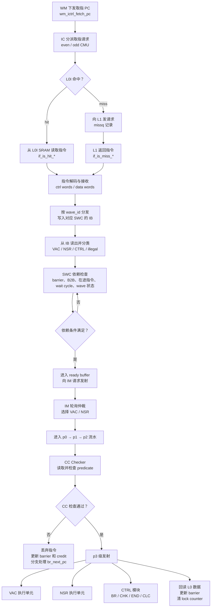

# ICTRL 指令处理流程

> 根据截图整理指令从取指、缓冲、依赖检查、仲裁、条件码检查到发射的过程。

本文内容来自用户提供的截图，信号含义、代码片段、行号和时序关系尚未对照 RTL 源码核实。图中重复的发射与执行内容仅记录一次。相关概览可参见 [ICTRL 模块学习](00-ICTRL%20模块学习.md)。

## 整体架构

截图将 ICTRL 描述为“取指 → 缓存 → 调度 → 发射 → 执行反馈”的流水线，核心模块例化关系如下：

```text
mt_mp_ictrl（核心）
├─ mt_mp_ictrl_if（取指前端）
│  ├─ mt_mp_ictrl_ic（L0I 数据通路 + 例化 ID 解码器）
│  │  ├─ mt_mp_ictrl_cmu（even/odd 目录，hit/miss 判定）
│  │  └─ mt_mp_ictrl_id（指令解码）
│  ├─ mt_mp_ictrl_missq（miss 请求队列）
│  └─ mt_mp_ictrl_pfm（prefetch 门限）
└─ mt_mp_ictrl_is（调度/发射核心）
   ├─ mt_mp_ictrl_swc ×16（每 wave 一个：依赖检查 + wave 状态）
   │  └─ mt_mp_ictrl_ib（指令缓冲队列）
   ├─ mt_mp_ictrl_im（仲裁/发射 + CC checker）
   └─ mt_mp_ictrl_ctrl（CTRL 指令执行：br/chk/end/clc）
```

截图给出的主路径是：**取指命中判定 → 解码 → 入 IB 缓冲 → 依赖检查 → 仲裁选择 → CC checker（条件码检查）→ 发射到 VAC/NSR/CTRL**。其中依赖检查和条件码检查是发射前的两道关卡。

## 指令处理流程图



流程图是对截图的概括：依赖不满足时的回路表示等待与重新检查，不代表已经核实具体的保持和重试时序。命中与未命中路径中解码和数据存储的具体时序也需结合 RTL 确认。

## 阶段 1：取指与接收（IF / IC / CMU / ID）

### 取指请求与 hit/miss 判定

WM 下发 `wm_ictrl_fetch_pc`，IC 按 `pc[1:0]` 奇偶分派给 even/odd 两个 CMU 做 hit/miss 判定（截图引用 `mt_mp_ictrl_ic.sv`）：

- **hit**：从 L0I SRAM（4 bank）读指令，通过 `if_is_hit_*` 传给 IS。
- **miss**：发送 `ictrl_il1` 请求给 L1，由 missq 记录；L1 返回后通过 `if_is_miss_*` 传给 IS。

### 指令解码（ID 模块）

截图描述 `mt_mp_ictrl_id.sv` 为纯组合解码器，调用 `decode_inst()` 将每条指令拆成 ctrl words（控制字段）和 data words（数据字段）：

```systemverilog
isa_decoded_inst0 = decode_inst(instr_data0);
ctrl_words0 = isa_decoded_inst0.ctrl;  // 控制字段
data_words0 = isa_decoded_inst0.data;  // 数据字段
```

解码后的 ctrl words 存入 `instr_ctrl_words_buf[0..3]`（4 bank），data words 写入 L0 SRAM（截图引用 `mt_mp_ictrl_ic.sv`）。

### 指令进入 IB

指令缓冲（Instruction Buffer，IB）接收 IC 命中或未命中返回的指令数据，按 `wave_id` 分发给对应 SWC，写入深度为 6 的队列（截图引用 `mt_mp_ictrl_swc.sv`）：

```systemverilog
wave_ib_wr_en = (if_is_hit_valid || if_is_miss_valid);
wave_ib_wr_data[0] = {nsr_instr, vac_instr, bank_id, cacheline_id, instr0_data};
```

IB 支持双写（dual FMA），并区分 `first_fma` / `second_fma`。

## 阶段 2：指令解码与分类（SWC）

指令从 IB 读出后，SWC 做指令类型解码（截图引用 `mt_mp_ictrl_swc.sv`）：

- `wave_ib_ctrl_instr`：CTRL 指令，如 BA、BR、LIMM、BRLT、BASR、BRSR、SLEEP、END、CLC、BKT。
- `wave_ib_vac_instr`：VAC 指令，如 FP、INT、CVT、BIT、FP64、FMA。
- `wave_ib_nsr_instr`：NSR 指令，如 MOV、LSU、SMP、SFU、IMAGE、BUFFER、ACE。
- `wave_ib_illegal_instr`：非法指令，截图举例为 opcode 无法识别或全零。

同时提取 `read_bar`、`write_bar`、`wait_mask`、`wait_cycle`、`bcc`（条件码）、`yield`、`burst` 等字段。

## 阶段 3：依赖检查（SWC）

截图说明依赖检查（dependency check）在 SWC 模块完成，核心信号为 `instr_dep_rdy`（截图引用 `mt_mp_ictrl_swc.sv`）：

```systemverilog
instr_dep_rdy = instr_bc_rdy && instr_bc_b2b_rdy &&
                instr_bc_vac_inflight_zero_rdy && instr_bc_nsr_inflight_zero_rdy &&
                instr_wc_rdy && (wave_fsm_c == ACTIVE_READY);
```

### Barrier Counter 检查

基于 BC 模块维护的 `bc_zero_status`（barrier 计数是否归零）和 `bc_max_status`（是否达上限），生成 `instr_bc_rdy`。

- **wait_bar 归零检查**（截图标注 L1371）：指令等待的所有 barrier 计数必须为 0。

  ```systemverilog
  instr_bc_zero_real_rdy =
      &((instr_wait_mask & bc_zero_status) | (~instr_wait_mask));
  ```

- **max 检查**（截图标注 L1400）：指令读/写的 barrier 不能已达上限。

  ```systemverilog
  instr_bc_max_rdy =
      ~(|(instr_read_bar_mask & bc_max_status) ||
        |(instr_write_bar_mask & bc_max_status));
  ```

- **false wait_bar 处理**：截图称 NSR 指令可提前发射，使用 `wave_wait_bar_flag` 跟踪。

### B2B 依赖检查

背靠背（back-to-back，B2B）检查对应 `instr_bc_b2b_rdy`。截图标注 L1445 的代码检查正在发射的指令（p0 级）与当前指令的 barrier 冲突：

```systemverilog
instr_bc_b2b_zero_rdy =
    ~(|(instr_wait_mask &
        (instr_issue_read_bar_mask_p0 | instr_issue_write_bar_mask_p0)));
```

### VAC/NSR 在途指令依赖

截图标注 L1446–1449：当本 wave 有 VAC/NSR 指令刚发射时，检查其 read/write bar 与当前指令的 `wait_mask` 是否冲突。相关信号为 `instr_bc_vac_inflight_zero_rdy`、`instr_bc_nsr_inflight_zero_rdy` 和 `ictrl_bc_vac_set_valid`。

### Wait Cycle 检查

截图标注 L1474–1478：指令带 `wait_cycle` 时，需要等待计数 `instr_wait_count` 达到指定周期数才可发射，对应 `instr_wc_rdy`。

### 其他依赖

- `instr_pso_wr_partition_active_rdy`：PSO_WR 发射需要 partition active。
- `wave_ib_instr_rdy_info_dmkill_valid`：dmkill 时暂停取指。
- `wave_ib_instr_rdy_info_trap_valid` / `bkt_valid`：trap/断点阻塞。

依赖检查通过后，指令推入 ready buffer（`i_instr_rdy_buffer`，截图标注 L1891），并产生 `swc_instr_issue_valid`（截图标注 L1972）向 IM 请求发射。

## 阶段 4：仲裁选择（IM）

截图描述 16 个 wave 的 `swc_instr_issue_*` 进入 IM，通过轮询（round-robin，RR）仲裁选出 VAC 和 NSR 指令（截图引用 `mt_mp_ictrl_im.sv`）：

- `vac_sel_mask`：选择 VAC 指令，包含 WC0 优先和 yield 处理。
- `nsr_sel_mask`：选择 NSR 指令。
- 同一 bank 的 VAC/NSR 不能同时发射，对应 `vac_nsr_same_bank_id_flag`。

选中后进入 **p0 → p1 → p2 → p3** 四级流水。

## 阶段 5：CC Checker（条件码检查）

截图描述 CC checker 在 IM 模块的 **p1 → p2** 级完成，根据指令的条件码（cc/bcc）和 predicate 寄存器的值决定指令是否发射。

### VAC 指令的 CC 检查

VAC 指令的 cc 字段 `vac_issue_info_stg1_p1_s.cc` 解码为 `ISA_CC_T_*` 类型（截图标注 L1618）：

- ~~`ET0T ET6T`（predicate 为真）、`ET0F ET6F`（predicate 为假）~~：截图中带删除线。
- `ETXX`：任意；`ALWAYS`：总是。

p1 级发起 predicate 读请求（`ictrl_pred_pn_vac_rd_valid` / `ictrl_pred_pe_vac_rd_valid`），p2 级用返回的 predicate 值做逐 instance 掩码（截图标注 L1793–1798）：

```systemverilog
vac_issue_cc_instance_p2 = cc_mask[1] ? instance & pe & pn :
                           cc_mask[2] ? instance & pe & (~pn) :
                           cc_mask[3] ? instance & pe :
                                        instance;
vac_issue_cc_result_p2 = (|vac_issue_cc_instance_p2);  // 任一 instance 满足即发射
```

### NSR/CTRL 指令的 CC 检查

截图称 NSR 指令的 bcc 字段解码为 `ISA_BCC_T_*`（L1656），支持：

- `ANYP0T`～`ANYP6T`：任一 predicate 为真。
- `ALLP0F` / `ALLP0T`：全部为假/真。
- `ANYPET` / `ALLPEF` / `ALLPET`：predicate 使能相关条件。
- `ALWAYS`：恒真。

p2 级计算 7 种 bcc 结果（截图标注 L1807–1823），最终由 `nsr_issue_cc_result_p2` 决定是否发射。

### CC 检查失败的处理

截图说明 CC 检查失败（`cc_result=0`）的指令会被丢弃（drop），并进行以下处理：

- 更新 barrier counter（L1825–1833）：`ictrl_bc_vac_clr_valid` / `ictrl_bc_nsr_clr_valid` 通知 BC 释放该指令占用的 barrier。
- VAC drop：`ictrl_vac_drop_valid`（L2461）。
- CTRL drop：`instr_ctrl_drop_valid`（L1840）。
- 分支指令：cc fail 时跳转 `br_next_pc`（`mt_mp_ictrl_br.sv`）。
- credit counter 递减：`vac_credit_cnt_drop_en` / `nsr_credit_cnt_min_en`。

## 阶段 6：发射与执行

截图称 CC 检查通过后，指令在 p3 级正式发射（L2168–2171）：

- **VAC 指令** → `ictrl_vac_issue_*`：发射到 VAC 执行单元，包含 instr_words/alu_sel/pc/bar。
- **NSR 指令** → `ictrl_nsr_issue_*`：发射到 NSR 执行单元。
- **CTRL 指令** → `im_chk/br/end/clc_issue_*` → ctrl 模块执行分支/检查/END/CLC。

发射时还会：

- 回读 L0 数据：`is_if_vac_rd_valid` / `is_if_nsr_rd_valid`。
- 更新 barrier counter：`ictrl_bc_vac_set` / `ictrl_bc_nsr_set`。
- 清 lock counter：`is_if_lc_clr_valid`。

## 待验证事项

- 对照 RTL 确认模块层级、各信号名及截图所列行号。
- 确认命中与未命中路径上的指令解码、存储和返回时序。
- 确认依赖检查、特殊等待条件、CC fail 处理及发射信号的实际触发条件。
